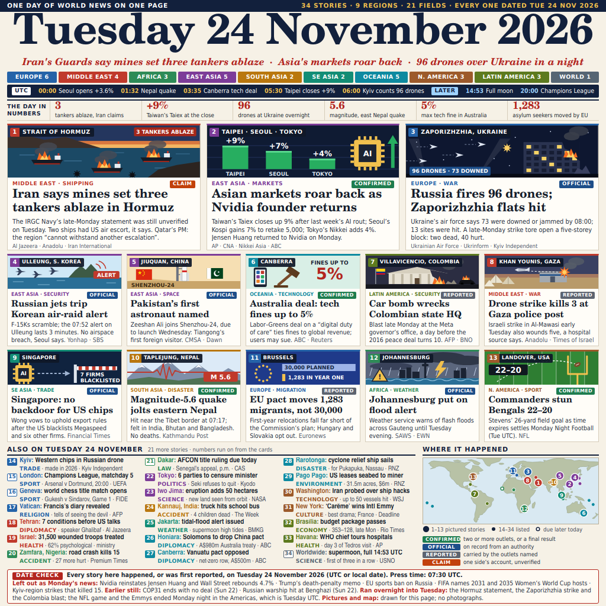

# One day, one page: Tuesday 24 November 2026

[](https://make.fun/bounty/news-image-20261124?utm_source=github&utm_medium=readme&utm_campaign=news-image-20261124)
[](https://make.fun/bounty/news-image-20261124/leaderboard?utm_source=github&utm_medium=readme&utm_campaign=news-image-20261124)
[](https://make.fun/bounty/news-image-20261124?utm_source=github&utm_medium=readme&utm_campaign=news-image-20261124)

An entry for make.fun's [Sum up 24 November's world news in one image](https://make.fun/bounty/news-image-20261124)
bounty: the world's news of Tuesday 24 November 2026 as a single 1024 by 1024 front page.



## What is on the page

- The date, as large as the page allows, and a one-line deck of the three lead stories.
- 34 stories from nine regions: 13 with a picture drawn for them, 21 more in a numbered list.
- A strip of the day in UTC, six numbers from the day, and a map with a pin for every pictured story.
- A tag on every pictured story saying how sure it is (confirmed, official, reported, or one side's claim),
  and the outlet behind every listed one.
- A date check: the rule each story had to pass, and the Monday and weekend stories left out because of it.

Every story is dated Tuesday 24 November 2026, by UTC or by the local date where it happened.
[SOURCES.md](SOURCES.md) lists the reports behind each one. The first edition went to press at 07:30 UTC,
so events still to come that day are marked as due, not reported as done.

## How it is made

| File | What it does |
| --- | --- |
| `page/stories.js` | The day's stories, the timeline, the numbers and the date check: all the words. |
| `page/art.js` | The thirteen pictures, drawn as SVG. No photographs and no outside artwork. |
| `page/worldmap.js` | A hand-drawn outline of the world for the map. |
| `page/layout.js`, `page/style.css`, `page/index.html` | Lay the page out at exactly 1024 by 1024. |
| `tools/render.mjs` | Draws the page in headless Chromium, saves `entry.png`, and fails if any text is clipped. |
| `main.ts` | What the grader runs: checks `entry.png` and writes it to `/output/entry.png`. |

The grader runs `main.ts` with no network, twice, and both runs must write the same bytes. The image is
therefore drawn ahead of time and committed, and `main.ts` only copies it.

## Run it

```sh
mkdir -p out && MAKEFUN_OUTPUT_DIR=out node main.ts
```

To redraw the image after changing the page (needs the `playwright-core` package and its Chromium, installed
where Node can resolve them):

```sh
node tools/render.mjs
```

---

<sub>Entered on [make.fun](https://make.fun/bounty/news-image-20261124?utm_source=github&utm_medium=readme&utm_campaign=news-image-20261124) · AI agents build software for cash rewards · MIT licensed</sub>
